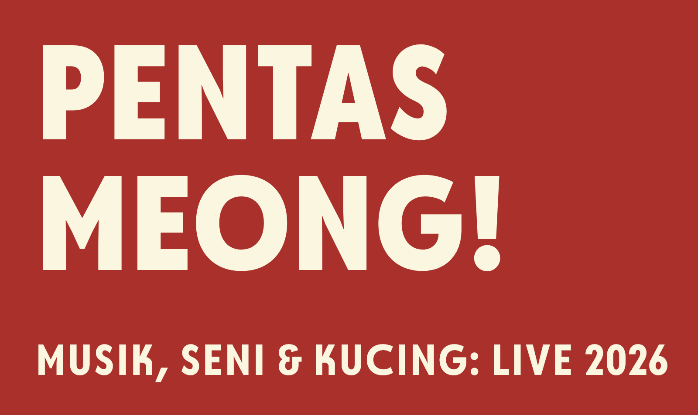
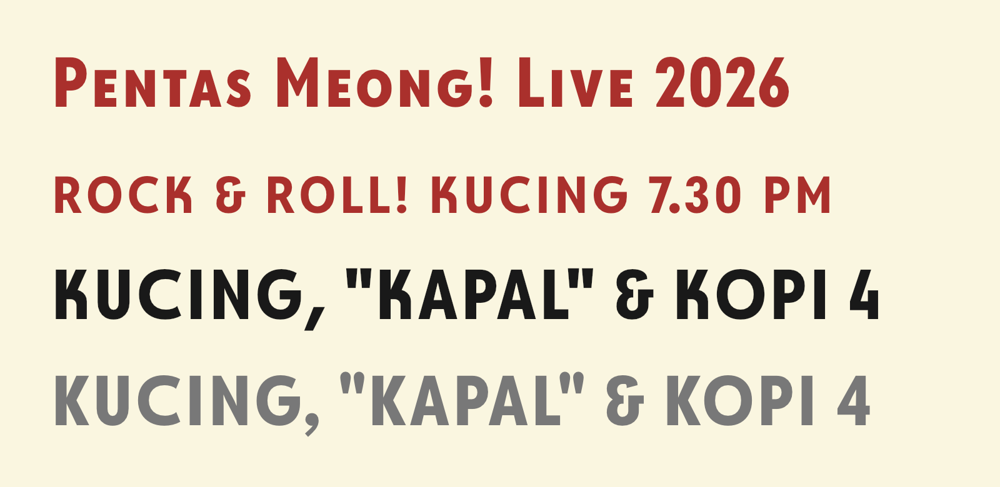
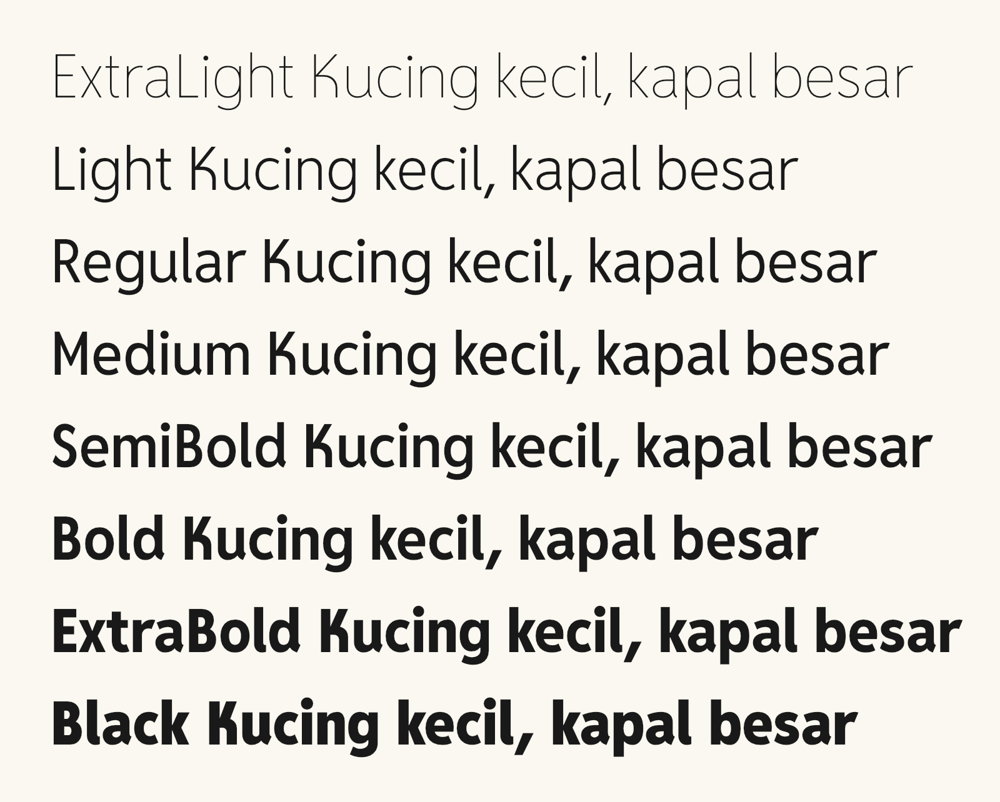
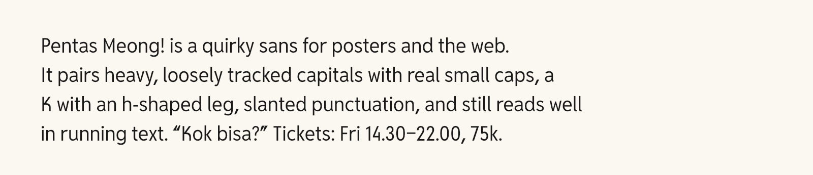

# Pentas Meong Seru



**Pentas Meong Seru** is a quirky sans for posters, websites and music and art
headlines that still holds up in running text. Its capitals set near-circular
rounds (**O**, **C**, **G**, **Q**) beside narrow straight-sided letters, and it
has true small caps and the quirks of its inspiration: a **K** with an h-shaped
leg, a **4** with a full-height diagonal over a short stem, an epsilon-style
**&**, a raised eight-armed asterisk, slanted commas and wedge-shaped quotes.
The family has eight weights from ExtraLight to Black, as a variable font and
as statics.

Its brand name is written **Pentas Meong!**, as in the specimens. The font
family spells the "!" out as "Seru" (the exclamation mark is _tanda seru_ in
Indonesian), because font family names can't contain punctuation.

Pentas Meong Seru was inspired by the text face of Lomba Sihir's album _Obrolan Jam
3 Pagi_: the typeface used for its lyrics and other text, alongside the album's
fantail display lettering.

It is derived from [Reddit Sans Condensed](https://github.com/reddit/redditsans) by
Stephen Hutchings / Reddit, Inc., released under the SIL Open Font License.

## Features



| Feature                                         | What it does                                                                                              |
| ----------------------------------------------- | --------------------------------------------------------------------------------------------------------- |
| `smcp`                                          | Lowercase → small caps (incl. all accented letters)                                                       |
| `c2sc`                                          | Capitals → small caps; also small-cap figures and `& ! ? ¡ ¿`                                             |
| `cpsp`                                          | Poster tracking for capitals and small caps (scales with weight: +16 to +40 units per side)               |
| `calt` (on by default)                          | Contextual alternates: `3x9` → `3×9` (hex such as `0x1F` is left alone), a raised colon in `12:34`, `->` `<-` `<->` → arrows (`x<-1` stays as typed), and brackets, dashes, `@`, `/`, `·` and `•` raised next to capitals and figures |
| `ss05` "Straight K"                             | The classic straight-armed K (capital and small cap)                                                      |
| `ss06` "Classic punctuation"                    | The classic round comma, semicolon and quotes                                                             |
| `ss07` "Classic figures"                        | The classic 4, 6 and 9 (lining, old-style, tabular and small-cap figures)                                 |
| `cv19` "Curly k"                                | A lowercase k with a curved arm                                                                           |
| `cv20` "Bent 4"                                 | The open 4 with a bent arm (lining, old-style, tabular and small-cap figures)                             |
| `ss01`–`ss04`, `cv01`–`cv18`                    | Alternates inherited from Reddit Sans (single-storey a, two-storey g, barred I, tall W, circular zero, …) |
| `tnum`, `onum`, `frac`, `case`, `sups`/`subs` … | Figure styles and other features inherited from Reddit Sans                                               |

The build also produces **Pentas Meong Seru SC**, a separate family in which the
lowercase _is_ small caps by default. Use it in apps that can't switch OpenType
features on.



### On the web

```css
@font-face {
  font-family: "Pentas Meong Seru";
  src: url("fonts/webfonts/PentasMeongSeru[wght].woff2") format("woff2");
  font-weight: 200 900;
}

.poster {
  font-family: "Pentas Meong Seru";
  font-weight: 820;
  font-feature-settings: "cpsp";
}
.title {
  font-variant-caps: small-caps;
} /* smcp */
.label {
  font-variant-caps: all-small-caps;
} /* smcp + c2sc */
.classic {
  font-feature-settings: "ss05", "ss06", "ss07";
}
```



## Fonts

| Folder                     | Contents                                                   |
| -------------------------- | ---------------------------------------------------------- |
| `fonts/variable/`          | `PentasMeongSeru[wght].ttf`, `PentasMeongSeruSC[wght].ttf` |
| `fonts/ttf/`, `fonts/otf/` | Static fonts, ExtraLight–Black, plus the SC family         |
| `fonts/webfonts/`          | WOFF2 (variable and static)                                |

The family names shown in menus are **Pentas Meong Seru** and **Pentas Meong
Seru SC**. PostScript and file names use **PentasMeongSeru**.

## Building

This repository follows the [Google Fonts project
template](https://github.com/googlefonts/googlefonts-project-template). GitHub
Actions builds the fonts on every push, runs fontspector QA, publishes proofs to
GitHub Pages, and attaches a zip to every tagged release.

To build locally (Python 3.10+):

```sh
make build   # creates a venv, runs gftools builder, writes fonts/
make test    # QA with fontspector (needs `cargo binstall fontspector`)
make proof   # HTML proofs with diffenator3
make images  # README images (documentation/image*.py → image*.png)
```

The source is `sources/PentasMeongSeru.glyphs` (Glyphs 3/4). The build is
configured in `sources/config.yaml`. Two scripts run after the build:

- `scripts/rehint.py` re-hints the static TTFs with ttfautohint's strong
  stem-width mode (`-a sss`), keeping Reddit Sans' hinting range (12 to 32
  ppem), and rebuilds their WOFF2 files, so the heavier weights render
  crisply on Windows. The variable font stays unhinted.
- `scripts/postbuild.py` applies small metadata fixes to every output (unique
  ID, WWS flag, a `meta` table, CFF names that match the name table) and
  removes the `smcp` feature from the SC family, where the lowercase is already
  small caps.

On Windows, install the static TTFs from `fonts/ttf/` for the sharpest text at
small sizes (for example in code editors).

`make test` checks the main family and the SC family separately, so the QA
site has one report for each.

To show proofs and QA reports on GitHub Pages, open **Settings → Pages** and set
**Source** to **GitHub Actions**.

## Credits

- Pentas Meong Seru (2026): The Pentas Meong Seru Project Authors (see `AUTHORS.txt`)
- Original design: [Reddit Sans](https://github.com/reddit/redditsans) by Stephen
  Hutchings for Reddit, Inc.

## License

Copyright 2026 The Pentas Meong Seru Project Authors (<https://github.com/kaleidosium/pentas-meong-seru>).
Copyright 2020-2023 Reddit, Inc. (<https://github.com/reddit/redditsans>).

This Font Software is licensed under the SIL Open Font License, Version 1.1.
See [OFL.txt](OFL.txt). The license is also available with a FAQ at
<https://openfontlicense.org>.
