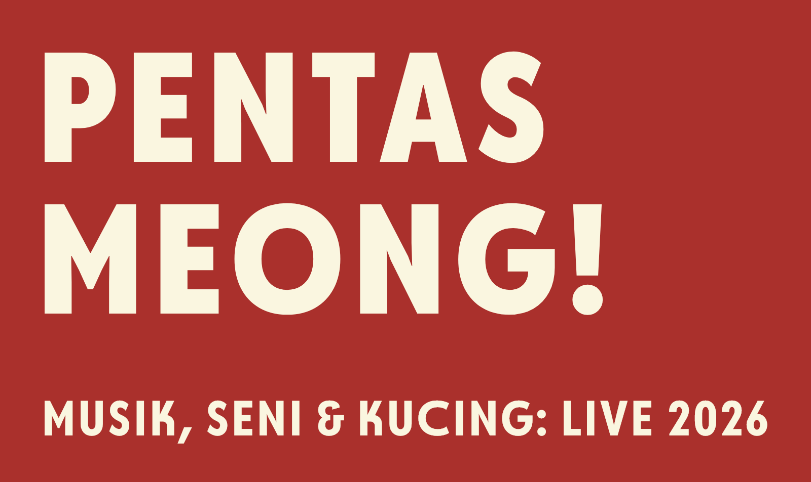
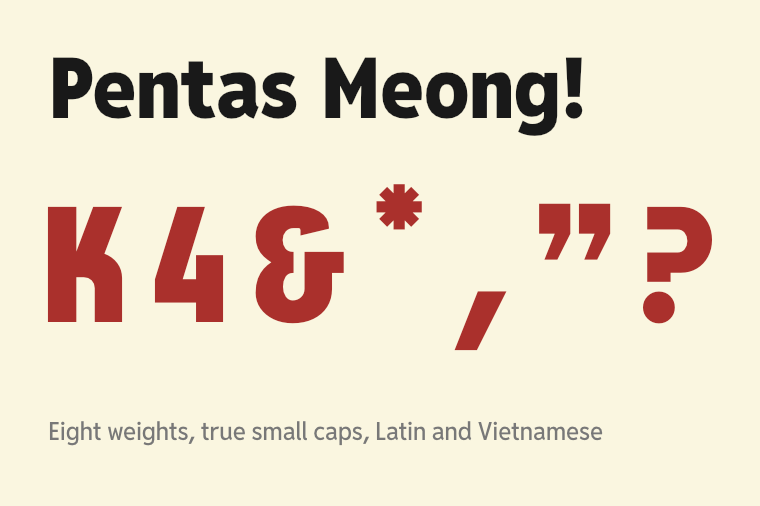
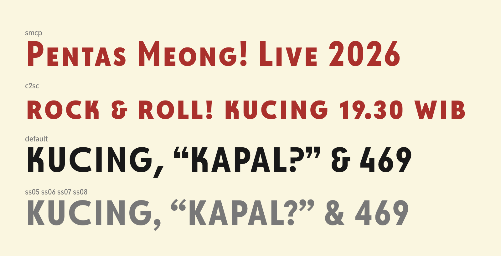
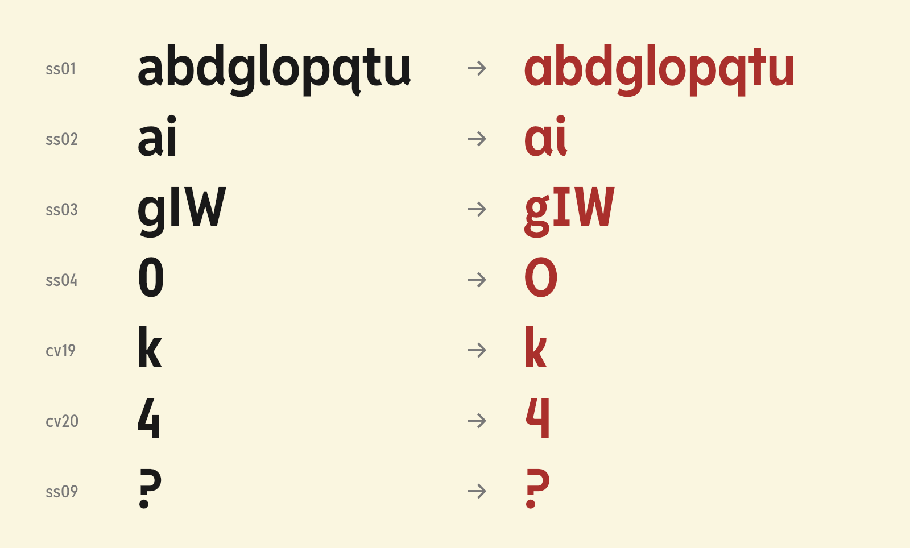
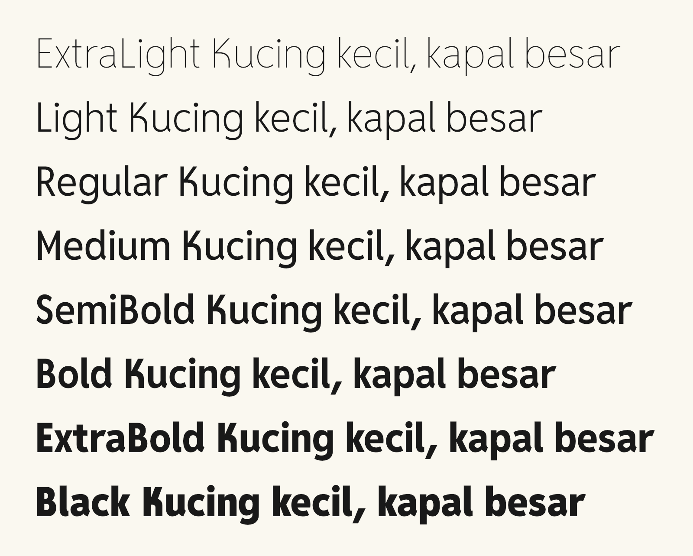
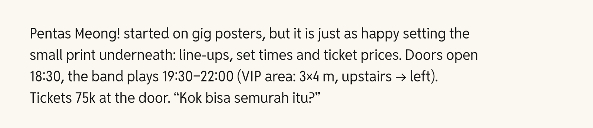

# Pentas Meong Seru

[![][Fontspector]](https://kaleidosium.my.id/pentas-meong-seru/fontspector/fontspector-report.html)
[![][OpenType]](https://kaleidosium.my.id/pentas-meong-seru/fontspector/fontspector-report.html)
[![][Universal]](https://kaleidosium.my.id/pentas-meong-seru/fontspector/fontspector-report.html)
[![][Google Fonts]](https://kaleidosium.my.id/pentas-meong-seru/fontspector/fontspector-report.html)
[![][Glyphset]](https://kaleidosium.my.id/pentas-meong-seru/fontspector/fontspector-report.html)

[Fontspector]: https://img.shields.io/endpoint?url=https%3A%2F%2Fkaleidosium.my.id%2Fpentas-meong-seru%2Fbadges%2FFontspectorQA.json
[OpenType]: https://img.shields.io/endpoint?url=https%3A%2F%2Fkaleidosium.my.id%2Fpentas-meong-seru%2Fbadges%2FOpentypeSpecificationChecks.json
[Universal]: https://img.shields.io/endpoint?url=https%3A%2F%2Fkaleidosium.my.id%2Fpentas-meong-seru%2Fbadges%2FUniversalProfileChecks.json
[Google Fonts]: https://img.shields.io/endpoint?url=https%3A%2F%2Fkaleidosium.my.id%2Fpentas-meong-seru%2Fbadges%2FFontFileChecks.json
[Glyphset]: https://img.shields.io/endpoint?url=https%3A%2F%2Fkaleidosium.my.id%2Fpentas-meong-seru%2Fbadges%2FGlyphsetChecks.json



Pentas Meong Seru is a quirky sans serif for gig posters, websites, and music and art headlines. It also holds up in running text, so one family can set a poster's title and the small print under it.

The round capitals O, C, G and Q are close to circles and sit beside narrow, straight-sided letters. A few shapes, inspired by the text face on a Lomba Sihir album, set the family apart:

- a K whose leg curves down from the stem like an h
- a 4 with a full-height diagonal over a short stem
- an ampersand shaped like an epsilon
- a raised asterisk with eight arms
- slanted commas, and quotes with square heads
- a question mark with a flat top



The family has true small caps and eight weights, from ExtraLight to Black, as a variable font and as static fonts. It covers the Latin script, including the complete Google Fonts Latin Core and Latin Vietnamese glyph sets.

## The name

The brand name is written Pentas Meong!, as in the specimens. Font family names can't contain punctuation, so the family name spells the "!" out as "Seru", from _tanda seru_, the Indonesian name for the exclamation mark.

## Origins

The inspiration for Pentas Meong Seru is the text face of Lomba Sihir's album _Obrolan Jam 3 Pagi_. That is the typeface used for the album's lyrics and other text, next to its fantail display lettering. The shapes listed at the top of this page are Pentas Meong Seru's own take on ideas from that face. Pentas Meong Seru isn't meant as a one-to-one recreation of the Lomba Sihir font.

The starting point for the outlines is [Reddit Sans Condensed](https://fonts.google.com/specimen/Reddit+Sans+Condensed), designed by Stephen Hutchings for Reddit, Inc. and released under the SIL Open Font License. Pentas Meong Seru has moved well away from it. The round letters are close to circles, the heavy weights are narrower, the capitals are re-spaced, and many glyphs are new or redrawn. It shouldn't be read as a plain Reddit Sans Condensed fork. [FONTLOG.txt](FONTLOG.txt) lists every change.

## Features

The fonts have small caps, a spacing feature for posters, contextual alternates that are on by default, and stylistic sets. The image below shows small caps, then the default forms in black and the classic forms from `ss05` to `ss08` in grey.



| Feature                                                   | What it does                                                                                                                                     |
| --------------------------------------------------------- | ------------------------------------------------------------------------------------------------------------------------------------------------ |
| `smcp`                                                    | Turns lowercase into small caps, including every accented letter                                                                                 |
| `c2sc`                                                    | Turns capitals, figures and `& ! ? ¡ ¿` into small caps                                                                                          |
| `cpsp`                                                    | Adds poster tracking to capitals, small caps and lining figures. It grows with the weight, from 16 units per side in ExtraLight to 40 in Black   |
| `calt`                                                    | Contextual alternates, on by default. The list after this table describes them                                                                   |
| `ss01` "Geometric forms"                                  | Straight-stemmed a b d g l o p þ q t u without tails. `cv01` to `cv11` apply them one at a time                                                  |
| `ss02` "Single-storey a, cursive i"                       | `cv12` and `cv13` apply them one at a time                                                                                                       |
| `ss03` "Two-storey g, barred I, tall W"                   | `cv14` to `cv17` apply them one at a time. The barred I and tall W also apply to small caps                                                      |
| `ss04`, `cv18` "Circular zero"                            | A circular zero, which also works with old-style figures. Tabular lining figures keep the normal zero, because a circle doesn't fit their column |
| `ss05` "Straight K"                                       | The classic straight-armed K, as a capital and a small cap                                                                                       |
| `ss06` "Classic punctuation"                              | The classic round comma, semicolon, quotes and question mark, with the matching ¿ and ‽                                                          |
| `ss07` "Classic figures"                                  | The classic 4, 6 and 9 in every figure style, including fractions, superiors and inferiors                                                       |
| `ss08` "Classic ampersand"                                | The ampersand of Reddit Sans Condensed, also as a small cap                                                                                      |
| `ss09` "Wide question mark"                               | A wider ? and ¿ for display sizes                                                                                                                |
| `cv19` "Curly k"                                          | A lowercase k with a curved arm                                                                                                                  |
| `cv20` "Bent 4"                                           | The open 4 with a bent arm, in every figure style                                                                                                |
| `tnum`, `onum`, `frac`, `case`, `sups`, `subs` and others | Figure styles and other features carried over from Reddit Sans Condensed                                                                         |

The contextual alternates (`calt`) make these changes as you type:

- `3x9` becomes `3×9`. Hexadecimal numbers such as `0x1F` keep their x.
- A colon between figures is raised, as in `12:34`.
- `->`, `<-` and `<->` become arrows. `x<-1` stays as typed.
- Dashes, `@`, `/`, `·` and `•` are raised next to capitals and figures.
- Brackets are raised as a pair around capitals and figures, as in `(OK)`, `(4)`, `(5%)` and `($5)`. They stay low around mixed-case text such as `(Anda)` or `(Jakarta, 1945)`.

The next image shows the other alternates, with the default form on the left and the alternate on the right.



### Pentas Meong Seru SC

The build also makes Pentas Meong Seru SC, a separate family whose lowercase is small caps. Use it in apps that can't turn OpenType features on. It has no `smcp` or `c2sc` feature. For all-small-caps text, use the main family with both features on.

## Weights

The weight axis runs from ExtraLight (200) to Black (900), with a named instance at every hundred.



The lighter weights are calm enough for text. This is Regular at text size:



## Using the fonts

The built fonts are in the `fonts` folder:

| Folder                     | Contents                                                      |
| -------------------------- | ------------------------------------------------------------- |
| `fonts/variable/`          | `PentasMeongSeru[wght].ttf` and `PentasMeongSeruSC[wght].ttf` |
| `fonts/ttf/`, `fonts/otf/` | Static fonts from ExtraLight to Black, for both families      |
| `fonts/webfonts/`          | WOFF2 fonts, variable and static, for the main family only    |

Font menus show the families as Pentas Meong Seru and Pentas Meong Seru SC. PostScript names and file names use PentasMeongSeru.

On Windows, install the static TTFs from `fonts/ttf/` for the sharpest text at small sizes, for example in code editors. The static TTFs are hinted and the variable font isn't.

### On the web

Load the variable WOFF2 with `@font-face` and turn features on in CSS. This example sets a heavy poster style with `cpsp`, small caps with `font-variant-caps`, and the classic forms with `ss05` to `ss08`:

```css
@font-face {
  font-family: "Pentas Meong Seru";
  src: url("fonts/webfonts/PentasMeongSeru[wght].woff2") format("woff2");
  font-weight: 200 900;
}

.poster {
  font-family: "Pentas Meong Seru";
  font-weight: 820;
  font-feature-settings: "cpsp";
}
.title {
  font-variant-caps: small-caps; /* smcp */
}
.label {
  font-variant-caps: all-small-caps; /* smcp + c2sc */
}
.classic {
  font-feature-settings: "cpsp", "ss05", "ss06", "ss07", "ss08";
}
```

## Building

GitHub Actions builds the fonts on every push. It runs fontspector's quality checks, publishes proofs and check reports to the [project site](https://kaleidosium.my.id/pentas-meong-seru/), and attaches a zip of the fonts to every tagged release.

To build on your own computer, you need Python 3.11.5 or newer, because the pinned requirements don't install on older versions. These `make` targets do the work:

- `make build` creates a virtual environment, runs gftools builder and writes the fonts to `fonts/`.
- `make test` runs fontspector. Install it first with `cargo binstall fontspector`.
- `make proof` writes HTML proofs with diffenator3.
- `make images` redraws the README images from `documentation/image*.py`.
- `make update` updates the pinned Python requirements in `requirements.txt`.
- `make update-project-template` brings in the latest Google Fonts project template. It needs Node.js.

The source is `sources/PentasMeongSeru.glyphs`, for Glyphs 3 or 4. `sources/config.yaml` configures the build, which hints the static OTFs with otfautohint from the afdko package. Two scripts run after the build:

- `scripts/rehint.py` re-hints the static TTFs with ttfautohint's strong stem-width mode (`-a sss`) and rebuilds their WOFF2 files. It keeps the hinting range of Reddit Sans Condensed, 12 to 32 pixels per em, and makes the heavier weights render crisply on Windows. ExtraBold and Black round the x-height up at 14 pixels per em, where the dots of i and j would otherwise run into the stem. The script also keeps alternates and small caps on the same pixel rows as the letters around them. It keeps the short stem of the question marks clear of the dot at the few sizes where hinting would join them. The variable fonts stay unhinted.
- `scripts/postbuild.py` fixes metadata in every font: the unique ID, the WWS flag, a `meta` table, and CFF names that match the name table. It gives each static font the `cpsp` values for its weight and drops the unused `grek` script from GSUB. It sets the ExtraLight OTFs' weight class to 275, as Google Fonts asks for CFF fonts, and sets the overlap flags in the variable fonts. In the SC family it encodes the lowercase directly as small caps and removes the `smcp` and `c2sc` features. Last, it rebuilds the variable WOFF2 from the finished TTF, which gives the WOFF2 a complete STAT table.

`make test` checks the main family and the SC family separately, and the project site has a report for each. It skips `googlefonts/metadata/unreachable_subsetting`, which only concerns how the Google Fonts API splits fonts into subsets. For the SC family it also skips `contour_count` and `alt_caron`, which expect lowercase shapes at lowercase code points.

## Changelog

### 1.000, 21 November 2026

First release. The main changes from Reddit Sans Condensed are:

- two families, Pentas Meong Seru and Pentas Meong Seru SC, each in eight weights
- new shapes for K, 4, 6, 9, the ampersand, the asterisk, the comma, the quotes and the question mark, with the old forms kept in stylistic sets
- near-circular round letters and narrower heavy weights
- small caps, the `cpsp` spacing feature and new contextual alternates
- new letters, including the ones that complete Hanyu Pinyin
- fixes to many problems inherited from Reddit Sans Condensed

[FONTLOG.txt](FONTLOG.txt) describes every change.

## Credits

Dania Rifki designed and produced Pentas Meong Seru. Stephen Hutchings designed Reddit Sans and Reddit Sans Condensed for Reddit, Inc., and Pentas Meong Seru is built on Reddit Sans Condensed. [AUTHORS.txt](AUTHORS.txt) lists the copyright holders.

## License

Copyright 2026 The Pentas Meong Seru Project Authors ([github.com/kaleidosium/pentas-meong-seru](https://github.com/kaleidosium/pentas-meong-seru)).
Copyright 2020-2023 Reddit, Inc. ([github.com/reddit/redditsans](https://github.com/reddit/redditsans)).

This Font Software is licensed under the SIL Open Font License, Version 1.1. The license is in this repository as [OFL.txt](OFL.txt) and is also available with a FAQ at [openfontlicense.org](https://openfontlicense.org).

## Repository layout

This repository follows the [Google Fonts project template](https://github.com/googlefonts/googlefonts-project-template). Its structure is inspired by [Unified Font Repository v0.3](https://github.com/unified-font-repository/Unified-Font-Repository), modified for the Google Fonts workflow. The folders hold these files:

- `sources/` has the Glyphs source and the build configuration.
- `fonts/` has the built fonts.
- `documentation/` has the article for Google Fonts and the scripts that draw the README images.
- `scripts/` has the post-build scripts and the start page of the project site.
